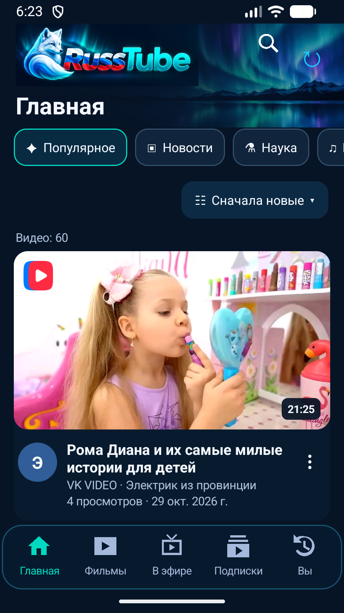
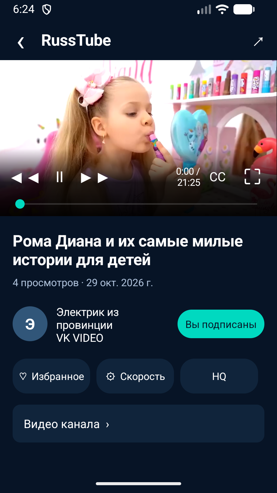
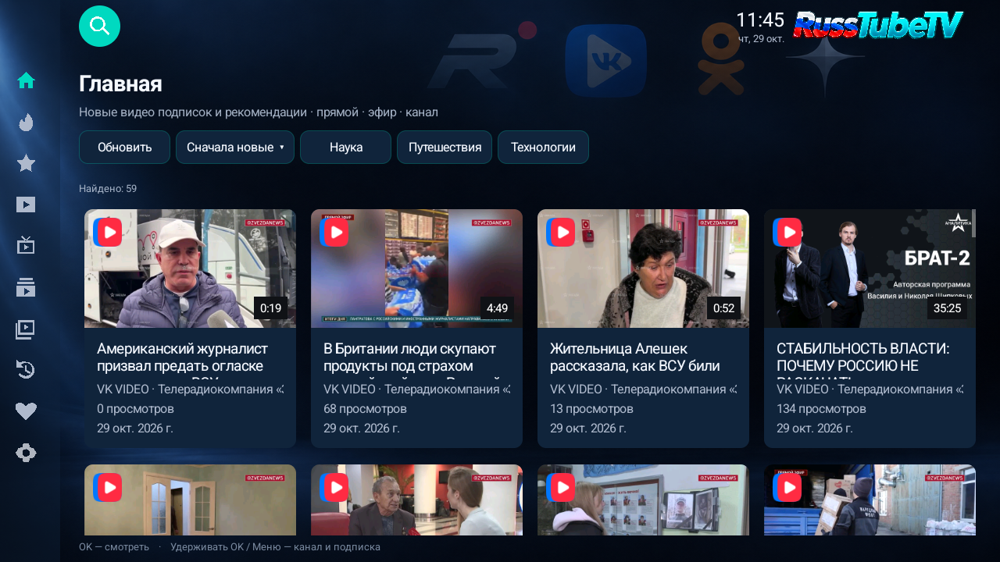
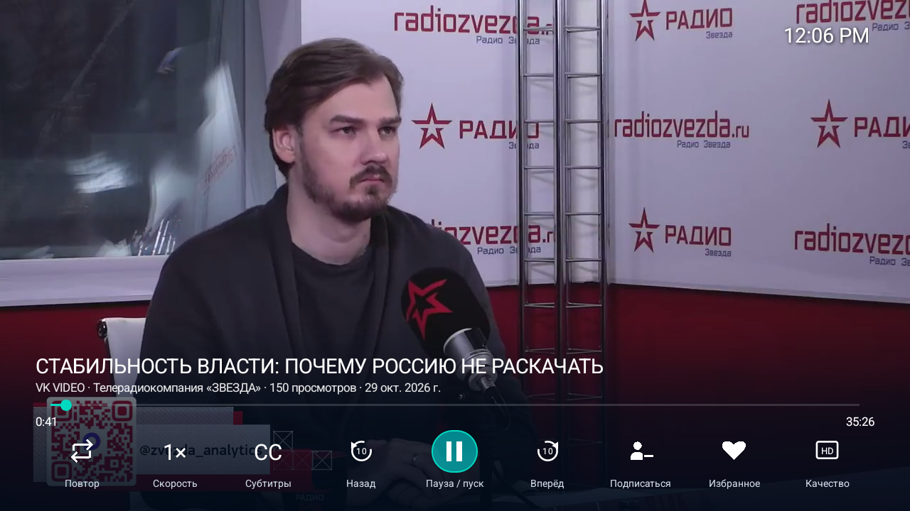

# RussTube

**Видео из разных источников — в одном приложении.** RussTube объединяет публичные видео и прямые эфиры RUTUBE, VK Видео, OK.ru, Дзена и PeerTube. Есть две отдельные версии: для телефона и для телевизора.

Для просмотра не требуется регистрация или вход в аккаунты видеоплощадок.

[Скачать RussTube для Android](https://github.com/alex-rek/RussTube/releases/download/v0.6.13/RussTube-Mobile-0.6.13-debug.apk) · [Скачать RussTubeTV](https://github.com/alex-rek/RussTube/releases/download/v0.6.13/RussTube-TV-0.6.13-debug.apk) · [Все релизы](https://github.com/alex-rek/RussTube/releases)

## RussTube для телефона

Мобильная версия для поиска и просмотра видео на смартфоне или планшете. На главной появляются рекомендации и новые видео подписок. В нижнем меню доступны фильмы, эфиры, подписки и личный раздел с историей, избранным и настройками. Плеер поддерживает полноэкранный просмотр, выбор качества и скорости, а также субтитры, когда они доступны у источника.

| Главная | Плеер |
|:---:|:---:|
|  |  |

## RussTubeTV для Android TV и Google TV

Телевизионная версия рассчитана на управление пультом: навигацию по карточкам, контекстные действия и настройки в боковых панелях. В приложении есть поиск, рекомендации, фильмы, подписки, история и избранное. В разделе «В эфире» телеканалы RUTUBE, VK Видео и OK.ru сохраняются в локальном каталоге и остаются доступными после перезапуска.

| Главная | Плеер |
|:---:|:---:|
|  |  |

## Возможности

- Поиск по нескольким видеоплощадкам и просмотр публичных видео в одном интерфейсе.
- Подписки на каналы и избранное сохраняются локально на устройстве, без привязки к аккаунтам площадок.
- Рекомендации формируются по истории просмотров и подпискам; доступны также история и подборки фильмов.
- Прямые эфиры и каталог телеканалов; доступность отдельных трансляций зависит от площадки и региона.
- Настраиваемое подключение через HTTP или SOCKS5-прокси с выбором площадок.
- Проверка новых выпусков на GitHub и предложение обновить приложение.

Проект Arctic Fox Apps основан на [0W-Tube](https://github.com/bolknote/0W-Tube). Исходная лицензия MIT сохранена в [LICENSE](LICENSE).
